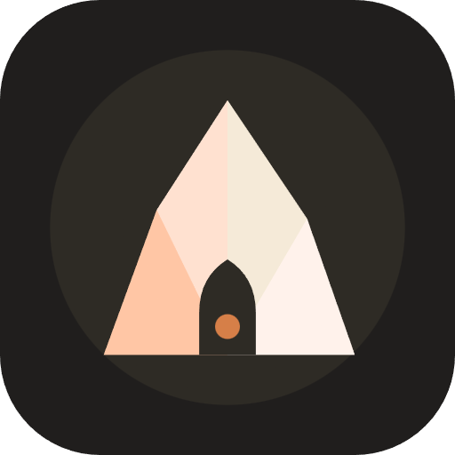

<p align="center">
  
</p>

<h1 align="center">Utumno</h1>

<p align="center">
  A clean desktop shell for Linux — top bar, app launcher, dashboard, music picker,
  wallpaper picker, lock screen, login screen, session menu, volume/brightness display
  and a local AI chat popup.
</p>

---

## What is this?

Utumno adds a desktop bar and a handful of everyday tools on top of a Wayland desktop:
a launcher to start apps, a dashboard with quick system stats, weather and music
controls, an album picker that plays through cmus, a picker to change your wallpaper, a
lock screen, an optional login screen (greeter), a menu to suspend/reboot/log out,
on-screen volume and brightness feedback, and a popup to chat with a locally-running AI
model.

It's built on **[Quickshell](https://quickshell.org)** (the `qs` command) and works on
**[niri](https://github.com/YaLTeR/niri)** and **[Hyprland](https://hyprland.org)** (Sway
and other similar compositors should work too, but are less tested).

> **Coming from [quickshell-d77](https://github.com/dani-77/quickshell-d77)?** Utumno
> now carries everything it had — including the dashboard, the music picker and the
> login screen — with the same look, keybinds and IPC names. The two share settings
> (the AI chat's last-used model, the wallpaper palette, the greeter's last login), so
> switching over is painless.

## Before you install

You need **Quickshell** (the `qs` command) installed and working, plus one of the
supported compositors (niri or Hyprland). See the
[Quickshell installation guide](https://quickshell.org/docs/master/start/installation/)
for your distribution.

## Installing

Clone Utumno straight into Quickshell's config folder:

```sh
git clone https://github.com/dani-77/utumno ~/.config/quickshell/utumno
```

**On Arch Linux**, it's in the AUR as
[`utumno`](https://aur.archlinux.org/packages/utumno) (`yay -S utumno`; the same
`PKGBUILD` lives in [packaging/arch](packaging/arch/PKGBUILD)).

**On Void Linux**, Utumno is also available as a proper `xbps-src` package —
see [void/README.md](void/README.md) for the template, or the [technical
documentation](doc/README.md#installation) for the manual/Makefile routes.

Then tell your compositor to start it automatically when you log in.

**On niri**, add this line to your `config.kdl`:

```kdl
spawn-at-startup "qs" "-c" "utumno"
```

**On Hyprland**, add this line to your `hyprland.conf`:

```
exec-once = qs -c utumno
```

Log out and back in (or restart the compositor) and the bar should appear at the top of
your screen.

## Using it

Once it's running, everything is driven from the bar or a few keyboard shortcuts.

On the bar (left to right): a **launcher** button to open apps, an **AI** button to open
the chat popup, then the clock, weather, CPU/RAM, volume, network and battery — and a
**power** button on the right to suspend, reboot, log out or shut down.

Click CPU or RAM to toggle the centered Eww system monitor. It uses `dgop` for data (or `atop` where there is no `dgop`) and the shared Matugen palette. The packages install `eww` and `dgop`; the Makefile carries the `monitor/` script and configuration with the shell.

Suggested shortcuts to add to your compositor config:

| Shortcut | Action |
|---|---|
| `Mod + D` | Open/close the app launcher |
| `Mod + Y` | Open/close the wallpaper picker |
| `Mod + L` | Lock the screen |
| `Mod + Shift + E` | Open/close the power menu |
| `Mod + I` | Open/close the dashboard |
| `Mod + M` | Open/close the music picker |
| Volume/brightness keys | Show the on-screen volume/brightness indicator |

**niri** (`config.kdl`):

```kdl
binds {
    Mod+D          { spawn "qs" "-c" "utumno" "ipc" "call" "launcher" "toggle"; }
    Mod+Y          { spawn "qs" "-c" "utumno" "ipc" "call" "wallpaper" "toggle"; }
    Mod+L          { spawn "qs" "-c" "utumno" "ipc" "call" "lockscreen" "lock"; }
    Mod+Shift+E    { spawn "qs" "-c" "utumno" "ipc" "call" "session" "toggle"; }
    Mod+I          { spawn "qs" "-c" "utumno" "ipc" "call" "dashboard" "toggle"; }
    Mod+M          { spawn "qs" "-c" "utumno" "ipc" "call" "musicpicker" "toggle"; }
}
```

**Hyprland** (`hyprland.conf`):

```
bind = SUPER, D, exec, qs -c utumno ipc call launcher toggle
bind = SUPER, Y, exec, qs -c utumno ipc call wallpaper toggle
bind = SUPER, L, exec, qs -c utumno ipc call lockscreen lock
bind = SUPER SHIFT, E, exec, qs -c utumno ipc call session toggle
bind = SUPER, I, exec, qs -c utumno ipc call dashboard toggle
bind = SUPER, M, exec, qs -c utumno ipc call musicpicker toggle
```

On Hyprland, Utumno also registers `GlobalShortcut`s (`quickshell:launcher`,
`quickshell:session`, `quickshell:lock`, `quickshell:dashboard`), so
`bind = SUPER, I, global, quickshell:dashboard` works too.

> **Tip:** all of those `qs -c utumno ipc call ...` commands can be shortened if you have
> [`qsd77`](https://github.com/dani-77/qsd77) installed — a small companion CLI for
> quickshell-d77 and Utumno. Since it targets quickshell-d77 by default, point it at
> Utumno with `-c utumno`:
>
> ```sh
> qsd77 launcher -c utumno
> qsd77 wallpaper -c utumno
> qsd77 locker -c utumno
> qsd77 session -c utumno
> ```

On wasp and spitfire, [Kantele](https://github.com/dani-77/kantele) can set up the
same keys for all the d77 shells: see its
[shell keys map](https://github.com/dani-77/kantele/blob/main/doc/shell-keys.md).

### The AI chat popup

There's no bar button for this one — the feature isn't consistent or reliable enough
yet to earn permanent bar real estate. Open it with a keybind instead:

```
bind = SUPER, A, exec, qs -c utumno ipc call ollamachat toggle
```

It's a chat window that talks to a [Ollama](https://ollama.com) instance running on
your own machine — nothing is sent anywhere else. If Ollama has no models installed
yet, Utumno downloads a small one automatically so there's something to chat with
right away; you can switch to a bigger model any time from the popup itself.

### The dashboard and music picker

`Mod + I` opens a panel below the bar with CPU/RAM/temperature/disk, the weather, a
network shortcut (`nmtui`), lock/log out/reboot/power off buttons and
[cmus](https://cmus.github.io) controls. If cmus isn't running, the music card offers
to start it headless (in `tmux`, or `screen`). The magnifier button (or `Mod + M`)
opens the music picker: type to search your albums (from cmus's library plus your XDG
music folder) and press `Enter` to play one.

These need a few optional tools: `cmus` for music, `ffmpeg` (`ffprobe`) for reading
album tags, `tmux` or `screen` to start cmus headless, and `lm_sensors` for the CPU
temperature (it falls back to the kernel's thermal zone). Anything missing just leaves
that card empty.

### The login screen (greeter)

`greeter/` is an optional native login screen for
[greetd](https://github.com/kennylevinsen/greetd), with the same look as the rest of
Utumno. Setting it up touches your system's login configuration, so it's a manual
step — see [greeter/README.md](greeter/README.md).

### Changing your wallpaper

Press `Mod + Y` (or click the wallpaper picker) to browse and pick a wallpaper from a
grid. Your choice is remembered and re-applied automatically the next time you log in.

## Uninstalling

```sh
rm -rf ~/.config/quickshell/utumno
```

...and remove the `spawn-at-startup`/`exec-once` line you added to your compositor
config.

## More

For architecture notes, the full list of modules, and the complete IPC reference, see the
[technical documentation](doc/README.md).

## License

MIT — see [LICENSE](LICENSE).
